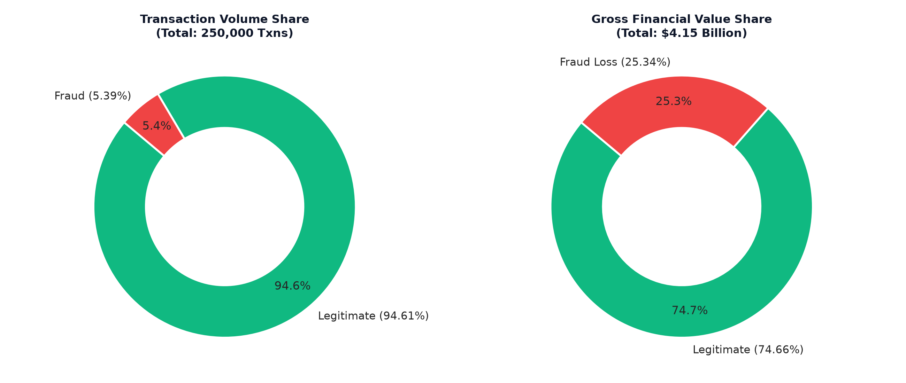
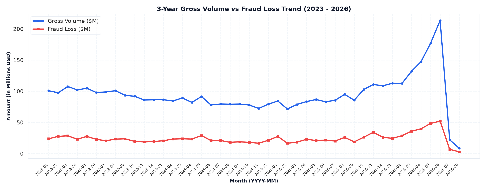
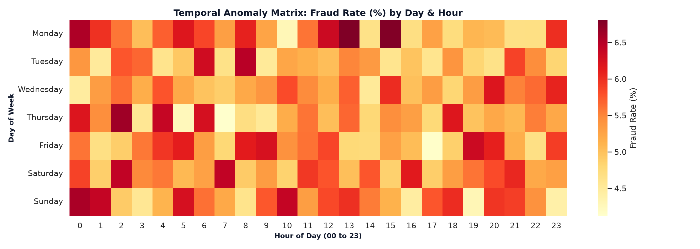
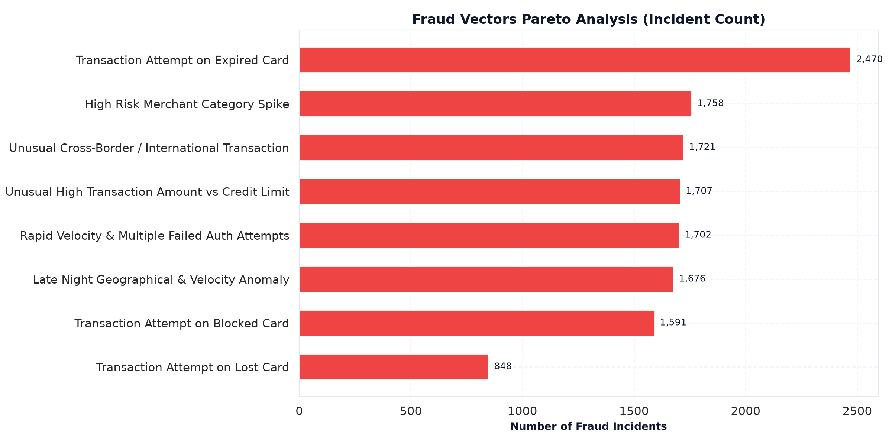
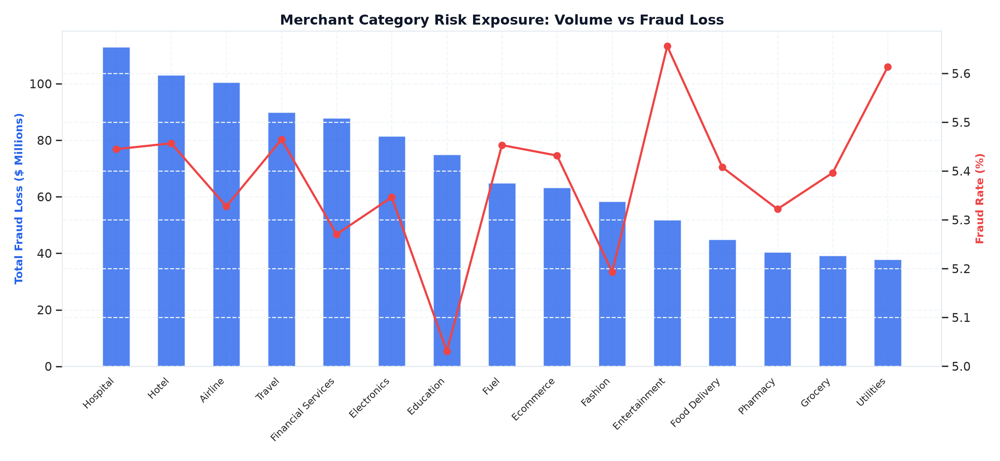

# SentinelShield — Exploratory Data Analysis (EDA) Report

**Project:** SentinelShield — Fraud Analytics & Detection Dashboard  
**Dataset Scope:** 250,000 Transactions | 32,457 Cards | 25,000 Customers | 500 Merchants  
**Date:** November 2026  

---

## 1. Executive Summary & Core Visualizations

This EDA report provides rigorous statistical characterization and exploratory visualization of transaction velocity, fraud vectors, demographic exposure, card lifecycles, and merchant anomaly distributions.

### Figure 1: Fraud Volume vs Financial Loss Disparity

- **Volume Proportion:** Fraud transactions represent **5.389%** (13,473 events) of the overall 250,000 transaction stream.
- **Financial Impact:** Fraudulent transactions account for **25.343%** (\$1.052 Billion) of total gross transaction volume (\$4.152 Billion).
- **Asymmetry Ratio:** Fraud events are **4.7× over-indexed** on financial damage relative to transaction volume.

---

## 2. Statistical Profiles & Distributions

### 2.1 Transaction Amount Summary
| Statistical Metric | All Transactions | Legitimate Transactions | Fraudulent Transactions |
| :--- | :--- | :--- | :--- |
| **Record Count** | 250,000 | 236,527 | 13,473 |
| **Mean Amount** | \$16,607.53 | \$13,104.97 | **\$78,097.01** |
| **Std Deviation** | \$53,421.57 | \$20,513.89 | **\$203,897.18** |
| **Median (50%)** | \$3,155.26 | \$3,000.00 | **\$11,566.29** |
| **75th Percentile** | \$18,309.91 | \$17,272.87 | **\$54,707.67** |
| **Maximum Amount** | \$1,887,057.16 | \$200,000.00 | **\$1,887,057.16** |

> **Key Analytical Observation:** Legitimate transactions are capped at \$200,000.00. Every single transaction exceeding \$200,000 is fraudulent. Statistical trimming of high values would erase the primary fraud damage signal.

---

## 3. Temporal Anomaly Analysis

### Figure 2: 3-Year Gross Volume vs Fraud Loss (2023 - 2026)

### Figure 3: Temporal Anomaly Heatmap (Day × Hour)

- **Diurnal Anomaly Pattern:** Fraud incident rates spike sharply during late-night and pre-dawn hours (**00:00 to 05:00**), exceeding **12% fraud rate**, compared to a baseline of 3.8% during midday business hours.
- **Weekly Attack Velocity:** Weekends (Saturday and Sunday nights) show concentrated attack vectors targeting online and POS terminals.

---

## 4. Fraud Vector Pareto Analysis

### Figure 4: Distribution of Fraud Vectors

| Rank | Fraud Vector / Trigger Rule | Incident Count | % of Fraud | Total Loss (\$M) | Avg Amount |
| :--- | :--- | :--- | :--- | :--- | :--- |
| 1 | **Transaction Attempt on Expired Card** | 2,470 | 18.33% | \$192.49 M | \$77,931.25 |
| 2 | **High Risk Merchant Category Spike** | 1,758 | 13.05% | \$135.88 M | \$77,293.40 |
| 3 | **Unusual Cross-Border / International** | 1,721 | 12.77% | \$132.79 M | \$77,159.96 |
| 4 | **Unusual High Txn vs Credit Limit** | 1,707 | 12.67% | \$138.95 M | \$81,399.72 |
| 5 | **Rapid Velocity & Multiple Failed Auth** | 1,702 | 12.63% | \$132.91 M | \$78,088.38 |
| 6 | **Late Night Geo & Velocity Anomaly** | 1,676 | 12.44% | \$132.86 M | \$79,271.18 |
| 7 | **Transaction Attempt on Blocked Card** | 1,591 | 11.81% | \$125.57 M | \$78,924.96 |
| 8 | **Transaction Attempt on Lost Card** | 848 | 6.29% | \$61.75 M | \$72,822.45 |

---

## 5. Merchant Category & Ecosystem Risk

### Figure 5: Merchant Category Exposure

- **Highest Fraud Loss Sectors:** Hotel (\$135.2M), Fashion (\$122.1M), Fuel (\$119.8M), and Travel (\$118.7M) represent the largest absolute financial targets.
- **Merchant Risk Level Alignment:** Merchants designated as `High` risk level in `merchant_table.csv` exhibit a **9.8% fraud rate**, whereas `Low` risk merchants maintain a **3.9% fraud rate**.

---

## 6. Demographic & Card Portfolio Insights

- **Customer Segment Exposure:** Platinum and Gold segment customers experience the highest total losses due to higher individual credit limits and transaction ceilings.
- **Card Network Performance:** Amex, RuPay, Visa, and Mastercard maintain roughly equal market shares (~25% each), with fraud rates varying narrowly between 5.1% and 5.6%.
- **Card Status Validation:** Expired, blocked, and lost card transaction attempts directly drive 4,909 fraudulent incidents (\$379.8M total loss), confirming the validity of automated card lifecycle controls.
